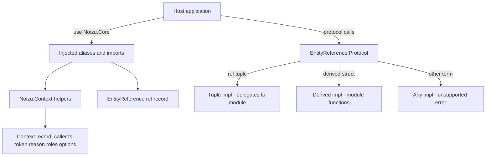

# Project Architecture

## Overview

`noizu_labs_core` is a pure in-process Elixir scaffolding library. It provides
two building blocks used across Noizu Elixir apps:

1. **Entity references** — a protocol that gives any term a polymorphic
   identity (`id`, `kind`, `ref`, `sref`, `entity`) backed by a lightweight
   `ref(module:, id:)` record.
2. **Request context** — a `context` record (caller, timestamp, token, reason,
   roles, options) with well-known role constructors and option accessors.

There is no runtime dependency, no process, no I/O, and no persistence: the
library is a set of functions, macros, records, and exceptions compiled into
the host application.

## System Diagram

## Core Components

| Component | Purpose |
|-----------|---------|
| `Noizu.Core` | `__using__` macro injecting `R` (EntityReference records) and `Context` imports into consumer modules |
| `Noizu.Context` | Context helpers: `with_option/3`, `with_options/2`, `option/2-3`; role constructors `restricted/internal/system/admin`; `dummy`, `dummy_for_user` |
| `Noizu.Context.Entity` | Stub placeholder entity used as the `caller` of role contexts |
| `Noizu.Context.Records` | Defines the `:context` record |
| `Noizu.EntityReference.Protocol` | `id/kind/ref/sref/entity` contract, `@fallback_to_any` |
| `Noizu.EntityReference.Records` | Defines the `:ref` record (`module`, `id`) |
| `EntityReference.Protocol` Tuple/Any impls | Ref-tuple delegation; structured unsupported fallback + `__deriving__` auto-derivation |
| `Noizu.Core.Helpers` | `ok?/2` result unwrapping (raises `ResultException`), `banner_text/4` formatting |
| `Credo.Check.Refactor.ABCSizePatch`, `Credo.Check.Readability.SinglePipePatch` | Dev-only custom Credo checks (EX4001, EX3023) |
| `Noizu.Core.ResultException`, `Noizu.EntityReference.ProtocolException` | Exception structs for result unwrapping and reference errors |

→ *Components ↔ directories: see [PROJ-LAYOUT.md](PROJ-LAYOUT.md)*

## Data Flow

Everything is in-process function calls following the `{:ok, _} | {:error, _}`
convention. Contexts are immutable records: role constructors build a fresh
`context()` around a `caller` ref; `with_option/with_options` return modified
copies. Entity-reference calls dispatch on the subject term — a `ref` tuple
delegates to its `module`, derived structs call their own module functions,
and anything else returns a structured `{:error, {:unsupported, _}}` rather
than raising. `Helpers.ok?/2` is the one raising path: it converts an
`{:error, _}` result into `Noizu.Core.ResultException`.

## Key Decisions

- **Protocol + `@fallback_to_any`**: unannotated types get an explicit
  `{:error, {:unsupported, _}}` instead of `Protocol.UndefinedError`; the
  `__deriving__` macro auto-derives implementations that delegate to the
  struct's own functions (the source comments a provider-based design as the
  eventual replacement).
- **Records over structs**: `context` and `ref` are Erlang records — cheap,
  pattern-matchable, dependency-free.
- **Roles are data, not enforcement**: `Noizu.Context.admin()` and friends
  merely populate the `roles` field; authorization is the consumer's job.
- **Raise-on-error is opt-in**: `ok?/2` throws `ResultException` for pipeline
  brevity; plain protocol calls never raise.

## Technology Stack

| Layer | Choice |
|---|---|
| Language | Elixir ~> 1.14 (CI runs 1.19.5 / OTP 28.5) |
| Runtime deps | None |
| Dev deps | credo ~> 1.7.12, ex_doc ~> 0.35 (both `runtime: false`) |
| CI | GitHub Actions — `mix compile --warnings-as-errors` + `mix test`; PR timing tracker (warn-only) |
| Publication | Hex package `noizu_labs_core` v0.1.8, MIT |
