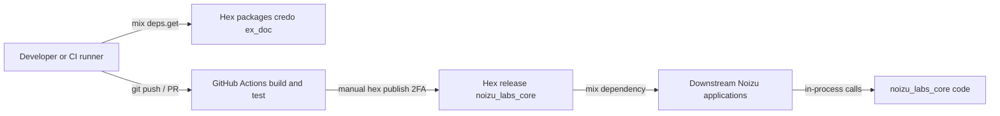

# Threat Model

## Overview

`noizu_labs_core` is an in-process Elixir library compiled into many consumer
applications (TRP, BOE, NPL, …). It runs no network listeners, touches no
persistence, performs no file I/O, and parses no external input. Its crown
jewels are therefore (1) the Hex release artifact that downstream apps trust,
and (2) the semantics of its context/role data, which consumers rely on for
authorization decisions. Grounding: [PROJ-ARCH.md](PROJ-ARCH.md),
[PROJ-LAYOUT.md](PROJ-LAYOUT.md).

## Attack Surface

Trust boundaries: developer/CI ↔ Hex registry ↔ downstream consumers (supply
chain). Inside a running consumer there is no boundary — the library executes
with the full privileges of the host BEAM process.

## Vulnerability Register

| ID | Severity | STRIDE | Component | Status |
|----|----------|--------|-----------|--------|
| T-001 | Medium | Elevation of privilege (downstream) | `Noizu.Context` roles | Accepted — by design; role fields are data, enforcement is the consumer contract (see Residual Risk) |
| T-002 | Low | Elevation of privilege | `Context.dummy/0-1`, `dummy_for_user/1-2` mint system-role contexts | Partial — docstring marks them placeholder ("easy to find and cleanup"); no compile-time guard against production use |
| T-003 | Low | Information disclosure | `ResultException` / `ProtocolException` embed caller-supplied `result`/`ref` payloads | Accepted — no secrets flow through this library; consumer logging hygiene applies |
| T-004 | Low | Spoofing / supply chain | Dev dependencies (credo, ex_doc) | Mitigated — both `runtime: false`, never loaded in a release beam |
| T-005 | Medium | Tampering / supply chain | Hex release of a widely-consumed package | Mitigated — manual release process, hex 2FA discipline (`CLAUDE.md`) |
| T-006 | Low | Tampering | GitHub Actions workflow | Partial — `setup-beam` pinned by commit SHA; `actions/checkout@v4` and `cache@v3` pinned by tag only |

## Mitigation Coverage

2 mitigated · 2 partial · 2 accepted. The partial items (T-002, T-006) are
cheap hardening candidates: a compile-time/test-time guard listing `dummy*`
usage, and SHA-pinning the remaining actions.

## Residual Risk

Accepted by design: any code in the host process can construct
`Noizu.Context.admin()` — the library cannot authenticate callers and does not
try; consumers must treat any `context()` crossing a trust boundary as
untrusted input and enforce roles at their own authorization points. Accepted:
exception structs carry caller-supplied payloads and rely on consumers not to
log sensitive data. The in-process surface adds no exposure beyond what the
host application already has.
